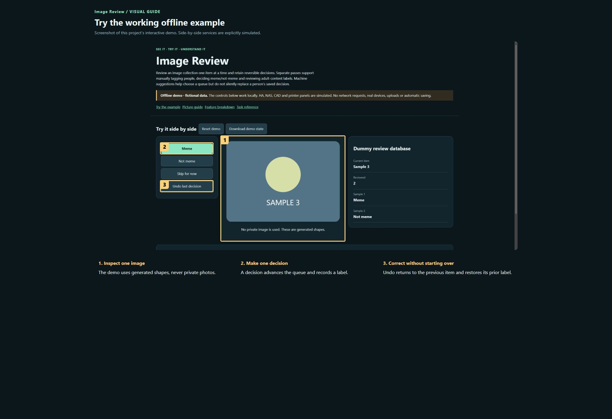

# Image Review

**Maintaining this project? [Start here](docs/START-HERE.md) · [Detailed handover](docs/HANDOVER.md)**

Review an image collection one item at a time and retain reversible decisions. Separate passes support manually tagging people, deciding meme/not-meme and reviewing adult-content labels. Machine suggestions help choose a queue but do not silently replace a person’s saved decision.

**Private preview · not published.**

[Open the visual manual](docs/USER-MANUAL.md) · [Download the self-contained demo](demo.html) · [Release notes](CHANGELOG.md)

Download `demo.html` using GitHub’s Download raw file control, then open it in your browser. GitHub displays HTML source; it does not run the demo on this page. The demo is an offline simulation with fictional data and makes no network requests.

## See it

### Try the working offline example

Screenshot of this project’s interactive demo. Side-by-side services are explicitly simulated.

1. **Inspect one image.** The demo uses generated shapes, never private photos.
2. **Make one decision.** A decision advances the queue and records a label.
3. **Correct without starting over.** Undo returns to the previous item and restores its prior label.

## What this tool does

| Feature | What it lets you do | Where |
| --- | --- | --- |
| Review passes | Separate people, meme and adult-content workflows. | Owner-only review |
| Queues and filters | Choose source bands, reviewed/unreviewed status, people and machine suggestion filters. | Owner-only review |
| Fast decisions | Use large buttons or supported swipe gestures; skip uncertain items. | Owner-only review |
| Undo and resume | Keep independent histories, retry a failed save and resume across devices. | Owner-only review |
| Learning | Use eligible human meme labels to update a constrained final decision filter. | Owner-only review |
| Exports | Export decisions and reversible history; original images remain untouched. | Owner-only review |

## A first useful workflow

### Choose a small review queue

1. Choose the intended Review pass before judging an image. Start with a manageable queue such as Borderline rather than treating every suggestion as a verdict.
2. Inspect the image; enlarge it when the detail matters. If the preview is unavailable, skip instead of guessing.
3. Use the appropriate positive/negative decision or Skip. Wait for saving to finish before assuming the next item represents a committed choice.

## Saving and outputs

Images/previews, names, labels and histories are private NAS data and are not included in this source repository. The demo uses generated sample shapes. Exported histories can contain sensitive annotations and should remain private unless reviewed.

## Running the actual tool

Use the authenticated hosted application; demo.html uses harmless fictional review items.

The demo has no prerequisites; the real tool may need the services described in the manual and retained source notes.

## Current boundaries

The app depends on the owner-authenticated gateway and persistent database. No private photographs are used in the shareable demo. No new classifier or private-image scan is run by this documentation work.

## Licence and sharing

MIT applies to original project contributions. Bundled/upstream software and assets retain their own terms; see [third-party notes](THIRD-PARTY.md). Keep this repository private until its own [release checklist](RELEASE-CHECKLIST.md) is complete and the owner authorises publication.
